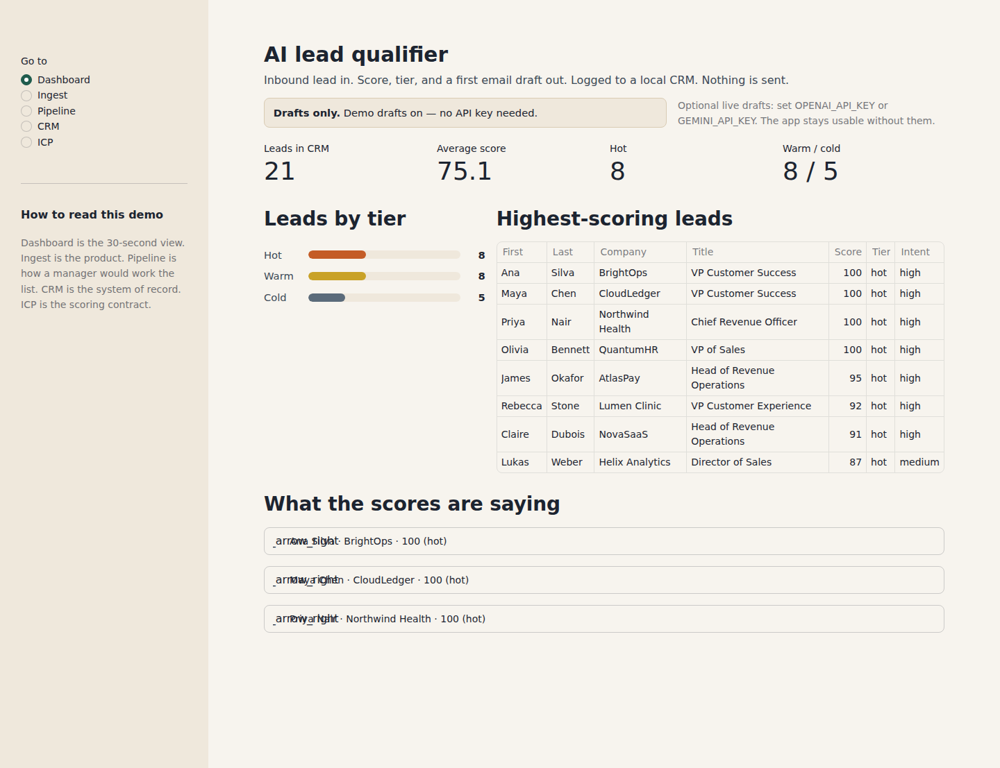
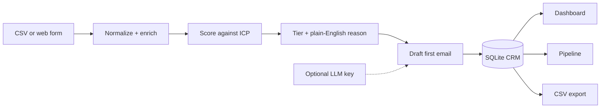

# AI Lead Qualifier

Scores inbound B2B leads against a written ideal-customer profile, drafts a first email, and logs the result to a local CRM — without sending anything.

## The business problem

Inbound forms, webinar lists, and event CSVs land in a spreadsheet. Someone on the sales team opens it when they can, guesses who is worth a call, and writes the first email from scratch. Good leads wait. Weak leads still get a meeting. The scoring rules live in one manager's head, so two people looking at the same row will disagree.

This demo is the operating rhythm I would give that team on day one: a shared score, a reason they can argue with, a draft they can edit, and a CRM row they can export.

## What it does

- Accepts a CSV upload or a single web-form submit (plus 20 fake sample leads so you can try it immediately)
- Fills in the obvious gaps from fields you already have — domain, seniority, size band, industry fit, intent
- Scores each lead 0–100 against a configurable ICP and explains the number in plain English
- Assigns a hot / warm / cold tier and drafts a personalised first email (never sent)
- Writes everything to a local SQLite CRM you can filter, update, export, and view as a pipeline plus a small dashboard

## Screenshot

The dashboard after the 20 sample leads have been scored. Average score, mix by tier, and the explanation behind the top rows:



## Architecture



Demo mode uses deterministic scoring and template drafts, so the app runs with no API key. If `OPENAI_API_KEY` or `GEMINI_API_KEY` is set, the email step asks the model for a draft and falls back to the template if the call fails.

## Quickstart

```bash
python3 -m venv .venv && source .venv/bin/activate
pip install -r requirements.txt
streamlit run app.py
```

Open the URL Streamlit prints (usually http://localhost:8501). The first launch loads 20 fake leads so the dashboard is not empty.

Run the tests with `pytest`.

Optional live drafts (still never sent):

```bash
export OPENAI_API_KEY=...          # or GEMINI_API_KEY
export OPENAI_MODEL=gpt-4o-mini    # optional
streamlit run app.py
```

Do not commit keys. There is no real customer data in this repo.

## How I'd take this to production

- Keep a human in the loop. The CRM status field is the start of that: an AE accepts or edits the draft before anything leaves the building.
- Replace the SQLite file with the system the team already lives in — HubSpot, Salesforce, or a shared Postgres — and ingest from the website form or Marketo instead of a CSV drop.
- Swap field-only enrichment for a real data vendor (Apollo, Clearbit) and treat those fields as evidence, not truth.
- Put the ICP in a place sales leadership can change without a deploy, and keep a versioned eval set of historical leads so a weight change cannot silently re-rank the queue.
- Add auth, an audit log, and a retention policy. Inbound notes are PII even when they look like a demo request.
- If you use an LLM for copy, cap spend, log prompts, and score drafts against a style guide. The number on the lead should stay deterministic so two managers can replay it.

## Tech stack

- Python 3.11
- Streamlit for the UI
- Pandas for CSV ingest
- SQLite as the local CRM (CSV export included)
- PyYAML for the ICP
- Optional OpenAI-compatible or Gemini HTTP call for email copy
- pytest and GitHub Actions for CI

---

Portfolio project by [Stefan Istoc](https://github.com/stefandevelops). I spent years in customer success and account management; this is the kind of inbound triage I wanted when the list hit the channel on a Friday.
